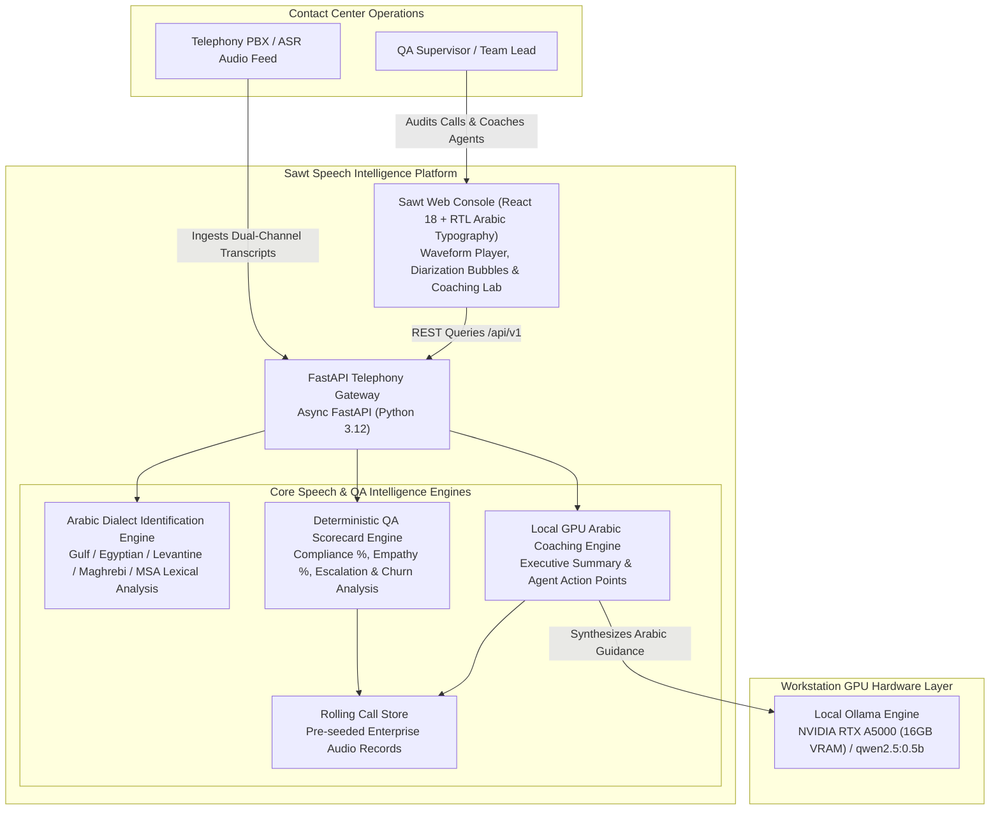
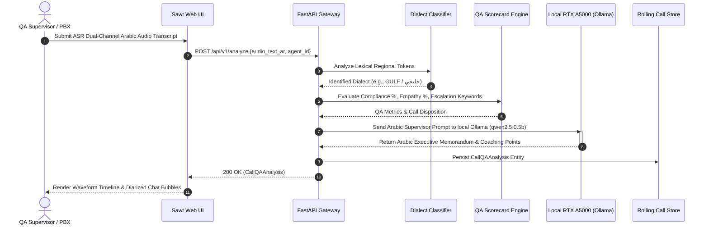

# Sawt (صوت) System Architecture & Arabic Speech Intelligence Design

Sawt is an enterprise **Arabic Speech Analytics and Automated Contact Center QA Platform**. It provides dialect identification across five major Arabic varieties (Gulf, Egyptian, Levantine, Maghrebi, MSA), speaker diarization turn analysis, compliance/empathy QA scorecards, and local GPU executive resolution coaching.

---

## 1. C4 Container Diagram

---

## 2. Speech Diarization & QA Coaching Sequence

---

## 3. Core Architectural Modules

### A. Arabic Dialect Identification (`qa_engine.py`)
- Analyzes regional speech tokens across five distinct Arabic dialect families:
  - **Gulf (خليجي)**: "شلونك", "وايد", "طال عمرك", "يبا", "زين", "أبي"
  - **Egyptian (مصري)**: "إزيك", "عايز", "كده", "دلوقتي", "أوي", "يا فندم"
  - **Levantine (شامي)**: "كيفك", "شو", "هيك", "كتير", "بدي", "هلأ"
  - **Maghrebi (مغاربي)**: "واش راك", "بزاف", "دابا", "مزيان"
  - **Modern Standard (فصحى)**: Modern formal Arabic expressions
- Execution speed < 5.0 µs per turn.

### B. Contact Center QA Scorecard Engine (`qa_engine.py`)
- Deterministic compliance checklist verification: standard greetings, security identification confirmation, and professional closing etiquette.
- Customer empathy and acoustic sentiment tracking.
- Real-time escalation trigger detection for supervisor interventions.

### C. Local GPU Arabic Coaching Engine (`coach_engine.py`)
- Leverages on-premise NVIDIA RTX A5000 GPU (16GB VRAM) via local Ollama.
- Generates high-quality Arabic supervisor memoranda and agent development recommendations with complete data sovereignty and zero cloud egress.
