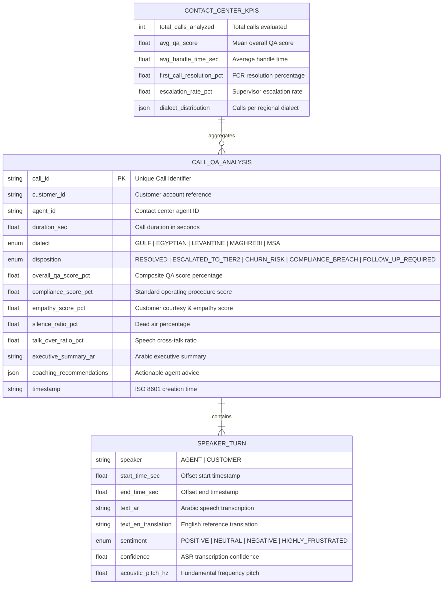

# Sawt Data Model & Speech Telemetry Schema

The Sawt data model organizes audio conversations into speaker turns, dialect classifications, acoustic metrics, and QA scorecard evaluations.

---

## 1. Entity-Relationship Diagram (ERD)

---

## 2. Arabic Dialect Typology

| Dialect Code | Region | Native Name | Sample Lexical Markers |
| :--- | :--- | :--- | :--- |
| `GULF` | Saudi Arabia, UAE, Kuwait, Qatar, Bahrain, Oman | خليجي | "شلونك", "وايد", "طال عمرك", "يبا", "زين", "أبي" |
| `EGYPTIAN` | Egypt, Sudan | مصري | "إزيك", "عايز", "كده", "دلوقتي", "أوي", "يا فندم" |
| `LEVANTINE` | Lebanon, Syria, Jordan, Palestine | شامي | "كيفك", "شو", "هيك", "كتير", "بدي", "هلأ" |
| `MAGHREBI` | Morocco, Algeria, Tunisia | مغاربي | "واش راك", "بزاف", "دابا", "مزيان", "برشا" |
| `MSA` | Pan-Arab Media, Formal Business, Legal | فصحى حديثة | "أهلاً وسهلاً", "مرحباً", "بخصوص", "أرجو" |
